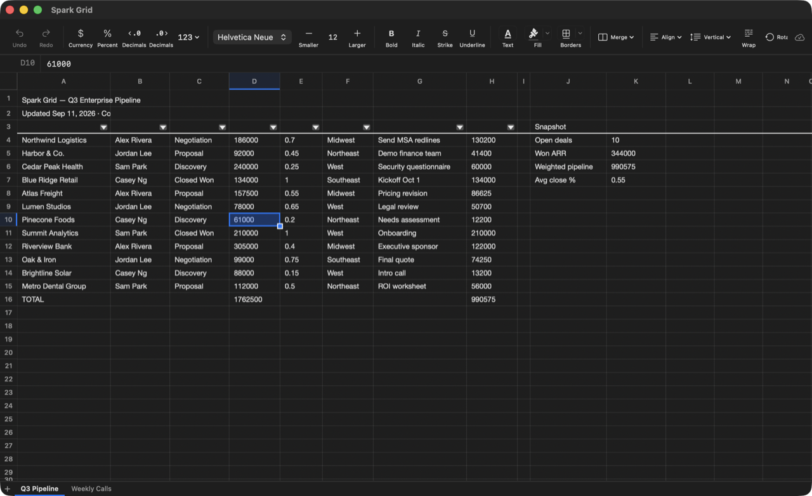

# Spark Grid

A free, native Mac spreadsheet for `.xlsx` and `.csv` files.

[](https://apps.apple.com/us/app/spark-grid/id6811196983?mt=12)



Spark Grid opens the spreadsheets people already have and saves them back as real `.xlsx` and `.csv` files, with no conversion to a format of its own. It is written in Swift, with SwiftUI around a custom AppKit grid, and it runs entirely on your Mac: no account, no analytics, and no network use.

Site: [sparkgridapp.com](https://sparkgridapp.com)

## What it does

- **Opens and saves `.xlsx` and `.csv`.** Formulas, number formats, fonts, fills, borders, merges, frozen panes, filters, conditional formatting and pictures come through a save.
- **Calculates as you type.** A formula engine with a lexer, parser and evaluator covers everyday functions, including lookups, conditional sums and counts, and text, date and rounding functions.
- **Feels like a Mac app.** A fast custom grid with fill handle, multi-range selection, zoom, find and replace, sort, AutoFilter, charts, printing, autosave and undo.
- **Handles big files.** A 50,000-row ledger opens, scrolls and saves without stalling.

The version on the Mac App Store is 1.1.1. This repository also holds work for 1.2: dropdown lists, comments, hidden rows and sheets, rule filters, fill series, and keeping parts of a file it does not edit yet (such as other apps' charts and pivot tables) so a save does not drop them.

## Build

Requirements: macOS 14 or later and a current Xcode.

```bash
open "Spark Grid.xcodeproj"
```

Or from the command line:

```bash
xcodebuild -project "Spark Grid.xcodeproj" -scheme "Spark Grid" -configuration Release build
```

Signing uses your own Apple Development team. The Swift packages (CoreXLSX, ZIPFoundation and XMLCoder) are fetched by Swift Package Manager.

## Tests

The spreadsheet engine is a Swift package with its own tests:

```bash
cd Packages/SparkGridCore && swift test
```

`scripts/ci.sh` is the full check run before every commit: lint, formatting, package tests, an app build, layering and privacy checks, a generated 50,000-row ledger workbook whose answers are checked cell by cell, and a command fuzzer.

## Layout

| Area | Location |
| --- | --- |
| App, windows, menus, dialogs | `Spark Grid/App`, `Spark Grid/Views` |
| The grid view | `Spark Grid/Grid` |
| Window state and editing | `Spark Grid/State` |
| Engine: cells, formulas, functions, `.xlsx` and `.csv`, number formats | `Packages/SparkGridCore/Sources` |
| Finder Quick Look preview | `Spark Grid Quick Look` |
| Website | `web` |

## License

Spark Grid's source is published under the [PolyForm Strict License 1.0.0](LICENSE.md). You may read it, build it and use it for personal, noncommercial purposes. You may not redistribute it, publish changed versions, or use it commercially. To get the app, download it free from the Mac App Store.

Fonts and Swift packages keep their own licenses. See [ATTRIBUTION.md](ATTRIBUTION.md).

Copyright 2026 Sam Parker.
